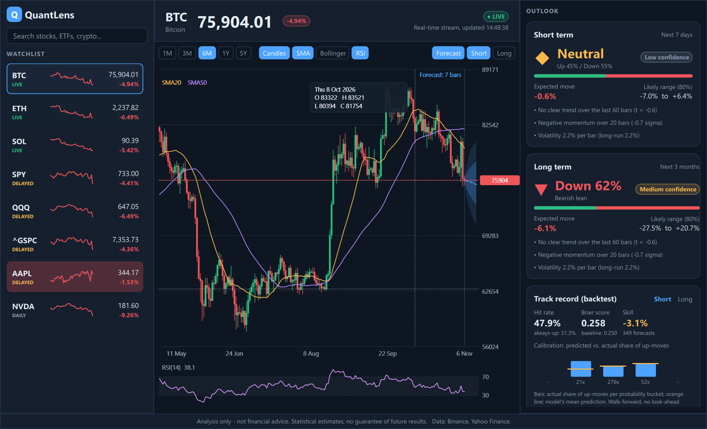

# QuantLens

Desktop app for **market analysis and statistical forecasts** of stocks, ETFs, indices and crypto
(S&P 500, Nasdaq, BTC, ETH, ...). It estimates the probability of an up/down move for a short and a
long horizon, shows the expected range as a probability cone on the chart, and **backtests its own
model** so you can see how reliable it really is.

> **Not a trading platform and not financial advice.** It places no orders and gives no recommendations.
> The numbers are statistical estimates from public price history.



## Features

- Watchlist with live price, daily change, sparkline and a green/red flash on every tick; search to add assets
- Candlestick/line chart, SMA 20/50, Bollinger bands, RSI, crosshair tooltip, timeframes 1M to 5Y
- **Outlook cards** (short and long horizon): probability up/down, expected move, 80% range,
  confidence level and plain-language reasons (trend, momentum, volatility, RSI)
- **Forecast cone** drawn into the future on the chart
- **Backtest card**: walk-forward hit rate vs. an "always up" baseline, Brier score, skill score, calibration bars
- Status badge per asset: `LIVE` (WebSocket), `DELAYED` (polled quote), `DAILY`, `CACHED`, `OFFLINE` (bundled demo data)
- Works offline with bundled sample data (`--offline`)

## Live data

| Asset class | Source | Mode |
|---|---|---|
| Crypto | Binance public WebSocket (`miniTicker`), no key | real-time, auto-reconnect with backoff |
| Stocks / ETFs / indices | Yahoo Finance chart endpoint (unofficial), polled round-robin | `DELAYED` - free sources have no tick stream |
| History | Binance klines / Yahoo chart, cached on disk | falls back to cache, then bundled sample |

Yahoo's endpoint is unofficial and can change or rate-limit; the app degrades to cached/sample data.
The bundled sample CSVs (`data/sample`) are demo snapshots created by `tools/fetch_sample_data.py`.

## The forecast model (transparent, no black box)

Implemented in plain C++17 in `src/core` (no Qt dependency):

1. **Drift**: shrunk blend of the long-run mean, the 60-bar log-price trend and a small momentum tilt.
2. **Volatility**: EWMA (RiskMetrics, lambda 0.94) mean-reverting to long-run volatility.
3. **Simulation**: 2000-path Monte Carlo using a filtered historical bootstrap of standardised residuals
   (keeps fat tails). Deterministic for a given seed.
4. **Output**: P(up), expected return, 10/25/50/75/90% price cone, confidence, reasons.

### Honest evaluation

`backtest()` replays history walk-forward (no look-ahead) and reports hit rate, Brier score and a skill score
against a base-rate baseline. Markets are close to efficient: on most assets the skill is around zero, and the app
shows that instead of hiding it. Treat the output as a structured view of trend and risk, not as a prediction machine.

## Architecture

```
src/core   pure C++17: indicators, forecast, backtest, CSV   (unit tested, no Qt)
src/data   Qt: asset catalog, MarketData (REST + cache), LiveFeed (QWebSocket + polling)
src/app    Qt Quick: AppController, WatchlistModel, ChartItem (QQuickPaintedItem), main
qml/       dark UI: Sidebar, TopBar, ChartPanel, ForecastCard, BacktestCard, Sparkline
tests/     GoogleTest (fetched via CMake)
```

- Analysis runs off the GUI thread (`QtConcurrent`); live ticks are throttled to the chart (250 ms).
- Forecasts are recomputed when history loads or the selection changes, not on every tick.
- Qt-free core makes the math testable and portable.

## Build

Requirements: CMake 3.21+, a C++17 compiler, Qt 6.5+ (Quick, QuickControls2, Network, WebSockets, Concurrent).

```bash
cmake -S . -B build -DCMAKE_BUILD_TYPE=Release -DCMAKE_PREFIX_PATH=<path-to-Qt>
cmake --build build
ctest --test-dir build --output-on-failure      # unit tests
./build/src/app/QuantLens                        # run
```

Core and tests only, without Qt: `cmake -S . -B build -DQL_BUILD_APP=OFF`.

Options: `--offline`, `--symbol BTC`, `--screenshot out.png [--delay ms]`.

For a distributable Windows build run `windeployqt` on `QuantLens.exe`.

## Limitations / ideas

- Daily bars only; the daily candle is updated from live ticks but forecasts are not re-run per tick
- Single-asset models; no portfolio or correlation view yet
- Possible next steps: GARCH volatility, regime detection, intraday timeframes, MACD pane, QML tests
